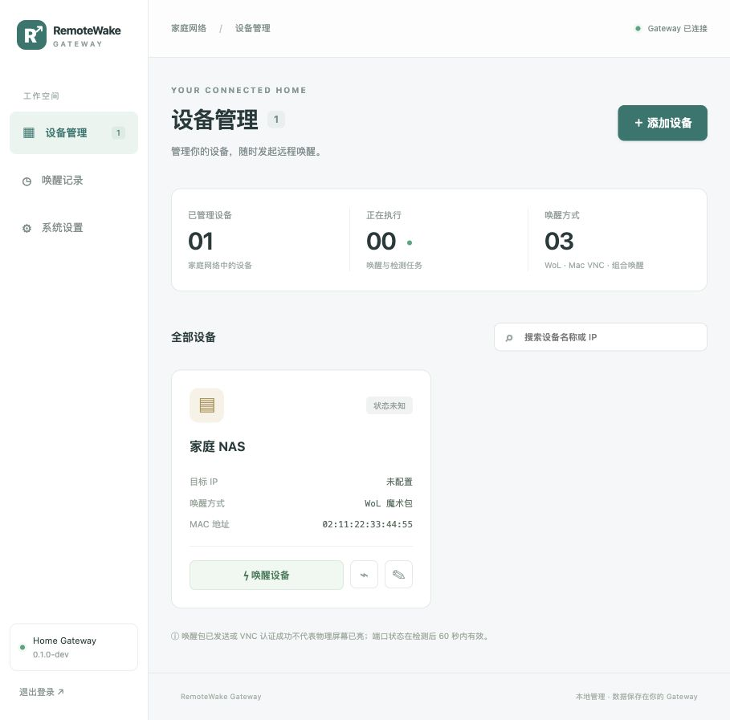

# RemoteWake Gateway

轻量级远程设备唤醒网关，支持 WoL、Mac 屏幕共享（VNC）及组合唤醒。Go 单程序，内嵌中文 Web 管理页面，使用 JSON 文件存储，不依赖数据库或运行时 Node.js。

当前版本：`0.1.0-dev`。已完成本地 Gateway 的第一版实现；真实设备与 NAS / 路由器兼容性仍需实机验收。完整设计见 [最终实现方案](docs/implementation-plan.md)，当前交付与验证边界见 [实现状态](docs/implementation-status.md)。

## 快速启动

已构建二进制时直接运行：

```sh
./bin/remotewake-gateway serve --data-dir ./data
```

默认访问 [http://127.0.0.1:8080](http://127.0.0.1:8080)。首次启动后，在另一个终端读取初始化令牌：

```sh
./bin/remotewake-gateway token --data-dir ./data
```

在页面输入令牌并设置 12–72 字节的管理员密码。令牌仅用于首次初始化；管理员设置完成后初始化接口关闭。不要公开令牌或整个数据目录。

也可在服务启动前通过标准输入初始化（避免把密码写入命令历史）：

```sh
./bin/remotewake-gateway init --data-dir ./data --password-stdin
# 输入密码后按回车，再按 Ctrl-D 结束输入；终端可能显示输入，推荐用密码管理器安全管道传入。
```

数据默认写入相对于当前工作目录的 `./data`。同一目录仅允许一个服务进程；`init` 必须在服务停止时使用。运行中会话只保存在内存，服务重启后需重新登录。

## 局域网与蒲公英访问

显式选择可供 LAN / VPN 访问的监听地址：

```sh
./bin/remotewake-gateway serve --data-dir ./data --listen 0.0.0.0:8080
```

通过 Gateway 的局域网或蒲公英可达地址访问。`--listen` 只覆盖本次运行；页面保存的监听地址需重启生效。使用防火墙限制来源，不将管理端口映射到公网。设置 Mac 真实密码优先使用本机或 HTTPS 反向代理；使用反代时设置 `public_url`，应用不信任任意转发头。

WoL 需要能到达目标所在 LAN。添加设备时，“发送网卡”默认设为“由系统选择”，由操作系统根据目标地址与路由表选择本地源地址；多网卡或 VPN 环境可手动选择目标 LAN 的接口。手动选择会绑定该接口的 IPv4 源地址，实际发送路径仍受系统路由影响；网卡不存在、未启用或没有 IPv4 地址时明确失败，不静默换到其他网卡。

选择网卡后会建议其子网广播地址，也可点击建议地址填入或自行修改；地址与网卡子网不一致时仅提示，不阻止保存和执行。已输入的 `255.255.255.255` 在切换网卡时会保留；使用该受限广播且由系统选择网卡时，若存在多个可用网卡，页面会提示明确选择目标 LAN 接口。广播地址不会自动扩散到所有网卡，实际广播效果需在目标网络验证。

默认允许的目标网段为 `10.0.0.0/8`、`172.16.0.0/12` 和 `192.168.0.0/16`，可在系统设置中调整。WoL 的 `255.255.255.255` 受限广播作为专用例外允许使用；其他 WoL 目标与 VNC / TCP 检测目标继续受允许网段限制，格式错误、未指定地址和多播地址仍会被拒绝。

## 唤醒方式

| 方式 | 配置要求 | 执行结果 |
| --- | --- | --- |
| WoL | MAC、LAN 广播地址和 UDP 端口 | 报告发送结果，可选等待指定 TCP 端口可达 |
| Mac 屏幕共享 | IP、VNC 端口、Mac 用户名和密码 | Apple DH(30) 认证，成功后断开或保持 0–30 秒 |
| WoL + Mac 屏幕共享 | 上述两组配置 | 先发送 WoL，即使发送失败仍尝试 VNC，分别报告结果 |

Mac 需开启屏幕共享、授权目标账户并满足网络唤醒条件。VNC 仅重试尚未成功的 TCP 连接，不重复认证；错误密码和认证结果不明会触发冷却，服务端限制认证时须检查账户后手动解除保护。VNC 只用于可信网络，不提供桌面画面、键鼠或剪贴板。

“Magic Packet 已发送”不等于“设备已开机”；TCP 可达不等于桌面就绪；VNC 认证成功不等于物理屏幕已亮。页面显示每个步骤的结果，检测观察超过 60 秒即显示状态未知。

## 任务与文件

- 设备列表支持勾选和“唤醒所选”，每批最多 50 台。页面内确认后逐台提交到同一任务系统，展示每台设备的结果；“停止后续”不撤销当前任务，当前任务结束后停止提交；“继续未完成”会查询已知任务或沿用原命令 ID，避免连接中断后重复认证。结果支持手动收起；收起后保留处理进度和停止 / 继续操作。全部成功后 5 秒自动收起，有异常时保持展开；处理完毕可关闭结果面板，仅隐藏反馈，任务记录仍可查询。新批次替换旧结果。批量编排在当前页面运行，关闭页面或刷新后，已创建的任务继续执行，尚未提交的设备不会自动执行，可从唤醒记录查看结果。
- 添加设备时，“上线检测与备注”默认折叠，纯 WoL 的可选目标 IP 也放在其中；Mac 模式的必填 IP 和认证配置仍直接显示。编辑已有检测、IP 或备注的设备时，相应区域自动展开。
- 系统设置中的“新设备默认参数”可配置默认广播地址、UDP 端口和发送次数，保存后立即生效；新建 API 未提供这些字段时同样使用当前默认值。修改默认值不会覆盖已有设备；旧配置缺少该设置时采用 `255.255.255.255`、端口 9、3 次发送。
- 添加设备时只需填写名称、设备类型、唤醒方式和对应参数，设备 ID 由后台自动生成，普通卡片和编辑表单不显示。重命名或修改类型不会改变 ID；API、CLI、导出配置继续保留该标识。创建 API 省略或留空 `id` 即自动生成，也兼容已有客户端提供的合法 ID；导入保留原 ID。
- 所有唤醒和 TCP 检测均为异步任务；浏览器关闭不会取消任务，可从唤醒记录查看进度。
- 同设备活动任务互斥；同 VNC 地址、端口与账户也共享互斥和认证保护。
- API 唤醒请求必须携带 `Idempotency-Key`。同 key 重试返回原任务；参数冲突则拒绝。
- 接受任务、开始执行、认证保护和终态按关键边界持久化；重启后遗留活动任务标为 `interrupted`，不自动重放。
- 存储失败后暂停接受新任务；检查磁盘并重启，不能靠重复点击绕过。
- 任务默认保留 7 天，最多 10000 条，容量不足且无法安全清理时拒绝新任务；不无限堆积记录。
- VNC 密码使用 AES-256-GCM 加密，密钥保存在 `data/secrets/credentials.key`。密文和密钥必须一起保护与备份；丢失密钥无法恢复密码。
- 修改目标 IP、VNC 端口或用户名时，须重新设置或明确清除密码。导出仅含公开设备配置；导入为新增模式，需预览确认，重复 ID 会被拒绝。

备份或手工编辑数据前停止服务，保留完整数据目录及文件权限。程序日志默认输出 stdout，不记录密码、密文或密钥。当前不支持自动 schema 迁移、热重载或自动升级。

## CLI

忘记管理员密码时，先用原运行方式停止服务，再使用本机恢复命令：

```sh
./bin/remotewake-gateway reset-password --data-dir ./data --password-stdin
```

通过标准输入提供 12–72 字节的新管理员密码（读取到 EOF），推荐从密码管理器安全管道传入。恢复命令获取与服务相同的数据目录锁，服务运行时拒绝操作；只更新管理员密码，不删除设备、VNC 密文及密钥或历史。完成后按原方式启动服务并用新密码登录。该能力仅供本机 CLI 使用，没有远程免登录重置接口；`init` 仍只负责首次初始化。

```sh
./bin/remotewake-gateway version
./bin/remotewake-gateway interfaces
./bin/remotewake-gateway check --data-dir ./data
./bin/remotewake-gateway wake --device mac-mini --url http://127.0.0.1:8080 --password-stdin
```

`wake` 从标准输入读取管理员密码，登录正在运行的 Gateway 后创建任务，不绕过任务保护直接读取 Mac 凭据；输出任务 ID，详情可在 Web 中查询。`check` 只读校验配置与设备，不替代运行时网络或凭据验证。

## 从源码构建

需要 Go 1.26 或更新版本，以及 Node.js 22.12+（建议 Node.js 26）。目标运行设备只需要编译后的可执行程序。开发环境的竞态测试另需 C 编译器。

```sh
sh scripts/build.sh
```

脚本先构建 Vue 前端，再将静态资源嵌入 Go 二进制。仓库也保留当前构建产物，若只修改后端可运行 `RWG_SKIP_WEB=1 sh scripts/build.sh`。

开发时可分别运行后端和 Vite；Vite 默认将 API 代理到 `127.0.0.1:8080`：

```sh
go run ./cmd/remotewake-gateway serve --data-dir ./data
cd web
npm ci
npm run dev
```

检查与构建 Linux 目标：

```sh
sh scripts/check.sh
GOOS=linux GOARCH=amd64 CGO_ENABLED=0 go build -trimpath -o bin/remotewake-gateway-linux-amd64 ./cmd/remotewake-gateway
GOOS=linux GOARCH=arm64 CGO_ENABLED=0 go build -trimpath -o bin/remotewake-gateway-linux-arm64 ./cmd/remotewake-gateway
```

测试只使用模拟发送器、内存连接或本机回环地址，不向真实设备发送唤醒指令。自动化覆盖系统自动选择、手动网卡源地址选择、多 IPv4 地址、实际 UDP 数据传输及广播目标校验；真实子网广播仍需局域网实测。

## Linux 与 NAS Docker

systemd 模板见 [服务文件](deployments/systemd/remotewake-gateway.service)。先创建 `remotewake` 服务账户，将二进制放到 `/usr/local/bin/remotewake-gateway`。服务首次默认仅监听本机，可通过配置文件设置 LAN / VPN 监听地址。用实际服务账户读取令牌和管理数据，避免 root 创建文件后普通账户无法读写。

Linux NAS 的 Docker 使用 host 网络，不需要 privileged 或额外网络能力。先创建绑定的数据目录，并让容器使用当前账户 UID/GID：

```sh
mkdir -p data
chmod 700 data
export RWG_UID="$(id -u)"
export RWG_GID="$(id -g)"
docker compose -f deployments/docker/compose.yaml up -d --build
docker compose -f deployments/docker/compose.yaml exec gateway remotewake-gateway token --data-dir /data
```

容器默认监听 `0.0.0.0:8080`，应限制宿主机防火墙；host 网络不使用端口映射。目标 NAS 必须支持 Linux host 网络。Docker Desktop 的网络行为不能替代 NAS 广播验收。

## macOS（launchd）

使用 [LaunchDaemon 模板](deployments/macos/com.lemoeo.remotewake-gateway.plist)，开机加载，不依赖用户登录；系统通过 `UserName` 指定的普通账户运行程序。模板的账户名 `remotewake` 是占位值，下面的安装命令会替换为当前账户，无需创建新账户。该方式遵循 [Apple 的 launchd 服务机制](https://developer.apple.com/library/archive/documentation/MacOSX/Conceptual/BPSystemStartup/Chapters/CreatingLaunchdJobs.html)。

### 安装和首次启动

在 Mac 上从项目根目录执行。先按“从源码构建”生成 `bin/remotewake-gateway`，或放入匹配本机架构的 macOS 二进制（Apple Silicon 为 `darwin/arm64`，Intel 为 `darwin/amd64`）；Linux 二进制不能在 macOS 运行。

以下命令由准备运行服务的本机普通账户执行，需要时通过 `sudo` 安装文件，勿直接在 root 登录会话中执行。数据和日志使用固定的绝对路径，Apple Silicon 与 Intel 均安装到 `/usr/local`：

```sh
RWG_USER="$(id -un)"
RWG_GROUP="$(id -gn)"
sudo mkdir -p /usr/local/bin /usr/local/var/lib/remotewake-gateway /usr/local/var/log/remotewake-gateway
sudo chown "$RWG_USER:$RWG_GROUP" /usr/local/var/lib/remotewake-gateway /usr/local/var/log/remotewake-gateway
sudo chmod 700 /usr/local/var/lib/remotewake-gateway /usr/local/var/log/remotewake-gateway
sudo install -o root -g wheel -m 755 bin/remotewake-gateway /usr/local/bin/remotewake-gateway
sudo install -o root -g wheel -m 644 deployments/macos/com.lemoeo.remotewake-gateway.plist /Library/LaunchDaemons/com.lemoeo.remotewake-gateway.plist
sudo /usr/libexec/PlistBuddy -c "Set :UserName $RWG_USER" /Library/LaunchDaemons/com.lemoeo.remotewake-gateway.plist
plutil -lint /Library/LaunchDaemons/com.lemoeo.remotewake-gateway.plist
sudo launchctl enable system/com.lemoeo.remotewake-gateway
sudo launchctl bootstrap system /Library/LaunchDaemons/com.lemoeo.remotewake-gateway.plist
/usr/local/bin/remotewake-gateway token --data-dir /usr/local/var/lib/remotewake-gateway
```

最后一条命令在服务首次启动生成令牌后执行；如果暂未生成，先检查服务状态和日志。访问 [http://127.0.0.1:8080](http://127.0.0.1:8080)，输入令牌并设置管理员密码。命令行初始化也须使用同一运行账户和数据目录，并先停止服务。

需要 LAN / 蒲公英访问时，在系统设置中将监听地址改为实际可达地址或 `0.0.0.0:8080`，保存后按下面步骤重启。只允许可信 LAN / VPN 来源访问管理端口。Mac 休眠时服务无法持续处理请求，应按网关的使用需求配置睡眠设置。

### 管理、升级与备份

查看状态和日志（应用的 Go 日志主要写入 stderr）：

```sh
sudo launchctl print system/com.lemoeo.remotewake-gateway
tail -n 100 /usr/local/var/log/remotewake-gateway/stderr.log
tail -n 100 /usr/local/var/log/remotewake-gateway/stdout.log
```

停止服务并等待命令返回：

```sh
sudo launchctl bootout system/com.lemoeo.remotewake-gateway
```

停止后可以备份完整的 `/usr/local/var/lib/remotewake-gateway`，或以原运行账户执行密码恢复；不要用 `sudo` 运行恢复命令，以免改变数据文件归属：

```sh
/usr/local/bin/remotewake-gateway reset-password --data-dir /usr/local/var/lib/remotewake-gateway --password-stdin
```

升级时先停止服务，再执行安装步骤中的二进制 `install` 命令；保留数据目录和已配置的 plist。恢复备份时同样先停服，恢复整个数据目录并确保仍归原账户所有、目录权限为 `700`。随后启动：

```sh
sudo launchctl bootstrap system /Library/LaunchDaemons/com.lemoeo.remotewake-gateway.plist
```

重启即依次执行 `bootout` 和 `bootstrap`，让应用收到终止信号并完成退出。仅执行 `bootout` 不取消下次开机加载；要长期停用，还需执行 `sudo launchctl disable system/com.lemoeo.remotewake-gateway`，恢复时先 `enable` 再 `bootstrap`。模板会在非零退出后尝试重新启动，并为停止操作预留 15 秒。

## OpenWrt（procd）

提供 [procd 服务脚本](deployments/openwrt/remotewake-gateway.init) 和 [UCI 配置](deployments/openwrt/remotewake-gateway.config)，适用于使用 procd 的 OpenWrt；无需 Node.js 或 Docker。脚本使用 [OpenWrt 官方 procd 接口](https://openwrt.org/docs/guide-developer/procd-init-scripts)管理前台进程、重启及系统日志。当前未提供 ipk / apk 安装包或 LuCI 页面。

### 准备二进制

先通过路由器的 `ubus call system board`、`uname -m` 和硬件资料确认 CPU 架构。在开发电脑按“从源码构建”生成嵌入的前端，再交叉编译 Linux 二进制。常见对应关系如下，OpenWrt 的软件包架构名不一定等于 Go 的 `GOARCH`：

| 路由器 CPU | Go 编译设置 |
| --- | --- |
| x86-64 | `GOOS=linux GOARCH=amd64 CGO_ENABLED=0` |
| ARM64 / AArch64 | `GOOS=linux GOARCH=arm64 CGO_ENABLED=0` |
| ARMv7（32 位） | `GOOS=linux GOARCH=arm GOARM=7 CGO_ENABLED=0` |
| MIPS（32 位） | 根据 CPU 大小端选择 `GOARCH=mips` 或 `GOARCH=mipsle`，并设置 `GOOS=linux GOMIPS=softfloat CGO_ENABLED=0` |

例如 ARM64：

```sh
GOOS=linux GOARCH=arm64 CGO_ENABLED=0 go build -trimpath -ldflags="-s -w" -o bin/remotewake-gateway-openwrt ./cmd/remotewake-gateway
```

已有的 Linux amd64 / arm64 构建也可用于对应架构；其他 CPU 需按实际架构编译。先确认设备的内核、可用内存和存储能运行该 Go 二进制。

### 安装和首次启动

以下以路由器 `192.168.1.1` 为例，按实际地址替换。在开发电脑的项目根目录上传文件；`-O` 使用传统 SCP 协议，适用于未安装 SFTP 服务的 OpenWrt：

```sh
scp -O bin/remotewake-gateway-openwrt root@192.168.1.1:/tmp/remotewake-gateway
scp -O deployments/openwrt/remotewake-gateway.init root@192.168.1.1:/tmp/remotewake-gateway.init
scp -O deployments/openwrt/remotewake-gateway.config root@192.168.1.1:/tmp/remotewake-gateway.config
ssh root@192.168.1.1
```

在路由器上执行以下首次安装命令。服务按 OpenWrt 的 root 账户运行，数据目录权限为 `700`，新建数据文件权限为 `600`：

```sh
cp /tmp/remotewake-gateway /usr/bin/remotewake-gateway
chmod 755 /usr/bin/remotewake-gateway
/usr/bin/remotewake-gateway version
cp /tmp/remotewake-gateway.init /etc/init.d/remotewake-gateway
chmod 755 /etc/init.d/remotewake-gateway
cp /tmp/remotewake-gateway.config /etc/config/remotewake-gateway
chmod 600 /etc/config/remotewake-gateway
/etc/init.d/remotewake-gateway enable
/etc/init.d/remotewake-gateway start
/usr/bin/remotewake-gateway token --data-dir /etc/remotewake-gateway
```

模板默认数据目录 `/etc/remotewake-gateway` 位于持久化存储，UCI 文件位于 `/etc/config/remotewake-gateway`。不要将数据放到重启后清空的 `/tmp` 或 `/var`；设备较多或历史写入量较大时，可在首次启动前将 `main.data_dir` 改为已挂载的持久化存储绝对路径，并保证开机启动时该存储已可用。更改路径不会搬迁已有数据，迁移时需先停服并完整复制原目录。

首次默认仅监听路由器的 `127.0.0.1:8080`。在电脑另开终端建立 SSH 转发并保持连接：

```sh
ssh -N -L 18080:127.0.0.1:8080 root@192.168.1.1
```

访问电脑上的 [http://127.0.0.1:18080](http://127.0.0.1:18080)，输入前面读取的令牌完成初始化。需要 LAN / 蒲公英直接访问时，可在 Web 系统设置中修改监听地址并重启服务；或在路由器设置 UCI 覆盖值：

```sh
uci set remotewake-gateway.main.listen='0.0.0.0:8080'
uci commit remotewake-gateway
/etc/init.d/remotewake-gateway restart
```

UCI 的非空 `main.listen` 每次启动都会覆盖应用 `config.json` 和 Web 中保存的监听地址。要恢复使用应用配置，将其设为空字符串并重启。防火墙仅允许可信 LAN / VPN 来源访问 TCP 8080，不添加 WAN 放行或公网端口转发；脚本不会自动修改网络或防火墙规则。

### 管理、升级与备份

```sh
/etc/init.d/remotewake-gateway status
logread -e remotewake-gateway
/etc/init.d/remotewake-gateway stop
/etc/init.d/remotewake-gateway start
/etc/init.d/remotewake-gateway restart
```

`enable` / `disable` 控制开机自启，UCI 的 `main.enabled` 控制脚本是否启动实例，两者需同时启用。长期停用可在 `stop` 后执行 `disable`，并将 `main.enabled` 设为 `0` 后提交；恢复时设为 `1`、提交，再执行 `enable` 和 `start`。UCI 或应用配置变更后显式 `restart`，不依赖应用热重载。进程退出后由 procd 尝试重启，间隔 5 秒；连续快速退出达到重试限制时停止重试，应检查日志后手动启动。

升级时先上传匹配架构的新二进制，执行 `stop` 后再复制到 `/usr/bin/remotewake-gateway` 并设为可执行，随后 `start`；不要覆盖已有 UCI 配置或数据目录。备份和恢复同样在停服后操作，保存完整数据目录（含 `secrets`、密钥和历史）及 `/etc/config/remotewake-gateway`；备份存放到路由器以外的位置。自定义数据目录须自行加入系统备份范围，不能仅假定 OpenWrt 配置备份包含全部应用数据。

忘记管理员密码时，停止服务后在路由器执行以下命令，通过标准输入提供新密码；若配置了其他 `data_dir`，相应替换路径。完成后重新启动服务：

```sh
/etc/init.d/remotewake-gateway stop
/usr/bin/remotewake-gateway reset-password --data-dir /etc/remotewake-gateway --password-stdin
/etc/init.d/remotewake-gateway start
```

OpenWrt 的实际开机自启、procd 重启和 LAN 广播效果仍需在目标路由器验收；本机静态检查不能替代实机验证。

## 后续开发

MQTT 云端中转、持久 outbox、云端用户与 Gateway 绑定、Windows 文件锁及自动服务安装器尚未实现。已提供 macOS launchd、OpenWrt procd 与 Linux systemd 服务模板，需按对应章节手动安装。现有业务层不依赖 HTTP，可在后续接入 MQTT 命令适配器。


