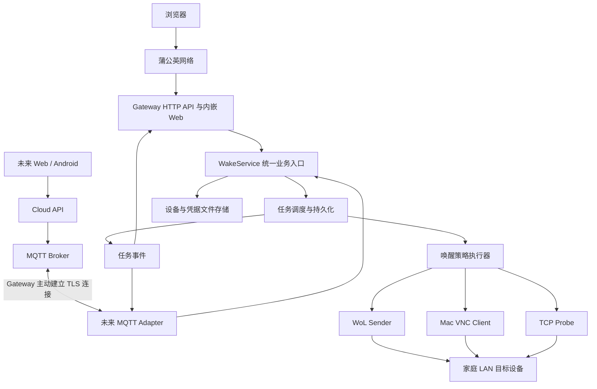

# RemoteWake Gateway 最终实现方案

日期：2026-11-11。状态：建议作为首版开发基线，尚未实施或完成实机验证。

本文依据 [RemoteWake Gateway 规划对话](chatgpt-conversation://6af3daa6-12ec-83e8-9277-1eaacd9fa872) 中逐步明确的需求整理。沿用最后确定的项目名称、文件存储约束和三种唤醒方式；下文任务恢复、接口细节、资源上限等是本次补充的实现决策。实现已经启动，当前交付范围见 [实现状态](implementation-status.md)。

## 1. 产品目标与范围

RemoteWake Gateway 是部署在家庭局域网、长期在线的设备唤醒服务。目标电脑无需安装本项目客户端；Gateway 必须保持供电，具备访问目标设备所在网络的能力。

第一阶段通过蒲公英提供网络连通，用户用浏览器访问 Gateway 的 Web 管理页面。第二阶段由 Gateway 主动连接云端 MQTT Broker，接收远程命令并上报任务结果；本地 Web 管理能力继续保留。

| 项目 | 最终选择 |
| --- | --- |
| 项目 / 仓库 | RemoteWake Gateway / `remote-wake-gateway` |
| 可执行程序 | `remotewake-gateway` |
| 计划 Go Module | `github.com/lemoeo/remote-wake-gateway`，创建远程仓库时核对归属 |
| 后端 | Go；优先标准库 `net/http`、`embed`、`log/slog` |
| 前端 | Vue 3 + TypeScript + Vite，构建资源嵌入 Go 程序；不依赖运行时 CDN |
| 存储 | JSON 文件；JSONL 用于可选历史归档；不使用 SQLite 或其他数据库 |
| 首版通信 | HTTP REST + 有限时长轮询，经蒲公英访问 |
| 唤醒策略 | `wol`、`mac_vnc`、`wol_mac_vnc` |
| 状态检测 | 按需 TCP 检测；首版不引入需要额外权限的 ICMP |
| 优先部署 | Linux 主机、树莓派、Linux NAS Docker |
| 后续适配 | OpenWrt / 兼容固件；macOS 和 Windows 原生运行 |
| 云端扩展 | MQTT 5.0 over TLS；客户端通过 HTTPS REST 访问云端 |

首版包含设备管理、三种唤醒方式、异步任务、凭据管理、管理员登录、任务历史、配置导入导出和部署说明。云端、多用户、Android 原生应用、实时 WebSocket、定时任务、自动发现、远程关机和桌面查看器放在后续阶段。蒲公英作为外部网络条件，不开发专属 SDK 或 `PgyerTransport`。

## 2. 整体架构



HTTP 和 MQTT 只负责认证、输入转换及结果传输，统一调用 WakeService。任务管理负责排队、去重、设备互斥、持久化、取消和恢复；策略执行器负责步骤顺序；WoL、Mac VNC、TCP Probe 只负责各自协议。

Gateway 最好直接成为蒲公英成员；也可使用已配置路由的成员访问 Gateway 的 LAN 地址。验收以“公司浏览器能访问 Gateway”为准，不假定任意蒲公英套餐或拓扑均支持同样的访问方式。

Magic Packet 由 Gateway 的家庭 LAN 网卡发出，不能依赖 VPN 转发广播。首版支持 Gateway 直接连接的 IPv4 广播域；跨 VLAN 需要额外路由或部署另一台 Gateway，不承诺自动穿透。

## 3. 唤醒行为与结果语义

### 3.1 三种策略

| 策略 | 流程 | 成功能够证明什么 |
| --- | --- | --- |
| `wol` | 构造 Magic Packet → UDP 广播 → 可选 TCP 检测 | 本地发送完成；有检测时可额外确认端口可达 |
| `mac_vnc` | TCP 连接 → RFB 协商 → Apple DH(30) 认证 → 可选保持 → 断开 | VNC 认证及配置的保持步骤完成 |
| `wol_mac_vnc` | 发送 WoL → 等待 VNC 可连接 → 单次认证 → 可选保持 → 断开 | 两步结果及 VNC 服务响应情况 |

WoL 不提供目标设备的标准回执；UDP 发送完成不等于开机完成。VNC 认证成功不等于物理显示器亮起，也不等于桌面已经可交互。TCP 连接失败只表示该次检测没有成功，不能直接显示“已关机”。

Mac 需开启屏幕共享、授权对应账户并配置网络唤醒；优先使用有线连接与 DHCP 地址保留。Apple 说明访问共享资源可以在适当条件下触发睡眠唤醒，但不能据此保证所有硬件、系统、网络和电源状态均可唤醒。[Apple 网络唤醒说明](https://support.apple.com/en-gb/guide/mac-help/mh27905/mac)

### 3.2 VNC 实现规则

参考 Shell-WoL 已有的 [Mac VNC 设计](https://github.com/lemoeo/Shell-WoL/blob/main/docs/mac-vnc-wake.md) 和 [协议模块](https://github.com/lemoeo/Shell-WoL/blob/main/internal/vncprobe/probe.go)，实现范围限定为 RFB 3.7/3.8 + Apple DH 安全类型 30。

- 认证成功后默认立即关闭连接，可额外保持 0–30 秒。
- 生产唤醒不发送 `ClientInit`，不请求画面、键鼠或剪贴板。
- 不支持 DH(30) 时明确失败，不降级到无认证或其他认证方式。
- 组合模式中 WoL 发送失败，记录错误后继续 VNC；配置、凭据预检失败则在任何网络操作前拒绝整个任务。
- 纯 VNC 和组合模式均仅在 TCP 尚未建立时允许重试。首次 TCP 建立后，协议失败、认证拒绝、认证结果丢失或保持失败均终止；同一任务不重新连接认证。
- 对错误密码、认证限流及结果不明的认证建立设备级冷却，建议默认 60 秒；跨新 command_id 生效并持久保存。明确收到认证限流时须人工检查账户，禁止后台循环尝试。
- 发送认证数据前先持久化“认证尝试中”保护记录；落盘失败不发送密码。认证成功可解除保护；若进程在认证期间退出，恢复时按结果不明进入冷却，不能通过新建 command_id 立即绕过。
- 用户名、密码遵循参考协议实现的 1–63 UTF-8 字节限制，拒绝 NUL、换行和静默截断。
- 限制服务端长度字段、DH 参数和读取量；所有网络读写有 deadline，取消会关闭 socket；不把服务端原始错误文本直接写入日志。

Apple DH 不提供基于证书的服务端身份认证，仅用于可信 LAN。它的协议密码运算与本地密码存储加密是两个独立机制，不得混用。

### 3.3 超时与默认值

| 参数 | 初始默认 / 限制 |
| --- | --- |
| WoL UDP 端口 / 次数 / 间隔 | 9 / 3 次 / 100ms；次数 1–10 |
| VNC TCP 端口 | 5900 |
| VNC 单次 TCP 连接超时 / 重试间隔 | 3 秒 / 1 秒；受整体预算约束 |
| VNC 或组合模式执行预算 | WoL、连接等待和认证合计最多 30 秒 |
| 认证后保持 | 默认 0 秒，最大 30 秒；总执行时间最多 60 秒 |
| WoL 可选上线检测 | 默认关闭；启用后最多 60 秒，每 2 秒一次 |
| 命令开始有效期 | 默认 60 秒；排队后开始前再次检查 |
| 并发与队列 | 全局最多 4 个执行任务，其中 VNC 最多 2 个；等待队列最多 16 个 |

命令过期时间限制“最迟开始执行”，任务开始后的执行 deadline 独立计算。任一设备同时最多一个活动任务；相同目标 IP、端口和用户名的 VNC 设备配置也共享认证互斥及冷却，避免复制设备绕过保护。

### 3.4 任务状态与观察结果分离

任务状态统一用小写：`pending`、`running`、`success`、`partial`、`failed`、`timeout`、`cancelled`、`expired`、`interrupted`。

`pending` 可进入 `running`、`expired`、`cancelled` 或恢复时的 `interrupted`；`running` 进入其余执行终态。终态不可回到运行态。`interrupted` 表示进程退出或崩溃后执行结果不明，不自动重放。

组合结果保留对话中“部分完成”的语义：

| WoL 步骤 | VNC 步骤 | 常规任务结果 | VNC 就绪结论 |
| --- | --- | --- | --- |
| 成功 | 成功 | `success` | 已验证认证；保持如配置也完成 |
| 成功 | 失败 | `partial` | 未验证成功 |
| 失败 | 成功 | `partial` | 已验证认证；WoL 步骤有错误 |
| 失败 | 失败 | `failed` | 未验证成功 |

整体 deadline 或取消优先决定 `timeout`、`cancelled`，之前已完成的步骤不丢失。纯 WoL 可选检测被配置为完成条件时，包已发送但检测失败为 `partial`，检测预算耗尽为 `timeout`。

设备观察单独保存 `unknown`、`reachable`、`service_ready`，并附 `observed_at`、`probe_type` 和结果有效期，建议 60 秒。普通 TCP 成功只标 `reachable`；VNC 认证成功可标 `service_ready`。过期显示“状态未知 / 上次检测时间”，不长期显示在线；不产生未经测量的 `display_awake=true`。

## 4. 数据模型与配置

设备公开配置示例：

```json
{
  "schema_version": 1,
  "revision": 1,
  "devices": [
    {
      "id": "mac-mini",
      "name": "客厅 Mac mini",
      "type": "mac",
      "enabled": true,
      "revision": 1,
      "wake_method": "wol_mac_vnc",
      "ip": "192.168.1.100",
      "wol": {
        "mac": "AA:BB:CC:DD:EE:FF",
        "broadcast": "192.168.1.255",
        "interface": "eth0",
        "port": 9,
        "repeat": 3,
        "interval_ms": 100
      },
      "vnc": { "port": 5900, "username": "macuser", "hold_seconds": 0 },
      "probe": { "enabled": false, "port": 22, "timeout_seconds": 60 },
      "note": "建议在路由器中保留 DHCP 地址"
    }
  ]
}
```

`wol` 必填 MAC、广播目标、有效端口；纯 WoL 的 IP 可选，启用检测时必填。两种 Mac 模式必填 IP、VNC 用户名、端口和本地凭据。`wol_mac_vnc` 同时满足两组要求；不再额外发起通用 TCP 上线检测。新建时显式选择策略；兼容导入缺失 `wake_method` 的旧设备时按 `wol` 处理。

首版目标使用 IP 字面量，广播和 VNC 目标必须属于管理员配置的允许网段；仅 WoL 的受限广播 `255.255.255.255` 作为专用例外允许使用。列出本地 IPv4 接口和广播建议，不自动扫描网络。WoL 发送网卡默认由系统路由选择，也可手动绑定所选接口的 IPv4 源地址；多地址接口优先选择匹配目标子网的源地址，否则使用该接口的第一个可用 IPv4 地址。广播地址不匹配本机或所选网卡子网时仅提示，允许自定义；显式网卡不存在、未启用或无 IPv4 时拒绝执行，不静默改用其他接口。

配置只保留实际使用的字段，包括稳定随机 `gateway_id`、监听地址、任务上限、历史保留策略、允许网段和日志等级。`gateway_id` 首次启动生成，此后升级保留；克隆数据目录创建另一台 Gateway 时必须重新生成身份。首版不写空 MQTT 配置。

## 5. 文件存储、凭据与恢复

设备 ID 为内部稳定标识，新建时由后台生成，Web 添加 / 编辑表单和普通设备卡片隐藏该字段；设备类型选择继续保留。名称或类型修改不改变 ID。API 返回、CLI 和导出仍包含 ID，已有客户端可继续提供合法 ID 创建，导入保留原 ID。

```text
data/
├── config.json                 # 全局配置，含 schema_version
├── devices.json                # 公开设备配置与 revision
├── jobs/                       # 按 job_id 保存任务规范记录，同时作为去重依据
├── history/                    # 可选按日期归档的 JSONL
├── runtime-policy.json         # 认证冷却等需要跨重启保留的策略
├── secrets/
│   ├── admin.json              # 管理员密码哈希
│   ├── credentials.json        # VNC 密文与绑定信息
│   └── credentials.key         # 随机 AES-256-GCM 主密钥
├── logs/                       # 可轮转运行日志，也可只输出 stdout
└── .lock                       # 进程持有的操作系统文件锁
```

### 5.1 写入和恢复

- 一个数据目录仅一个写进程；启动获取 OS 文件锁。不能使用“文件存在即占锁”的方式，也不能靠删除锁文件恢复。
- JSON 使用同目录临时文件 → Sync → Close → 原子替换；支持的平台还需同步父目录。失败不发布新的内存状态。Windows 的替换与断电保证单独适配并验证。
- 持久化操作有大小上限和 schema 校验；迁移前备份，遇到未知更高版本或损坏文件明确停止相关功能，不覆盖为空配置。
- `jobs/{job_id}.json` 是任务及幂等的规范记录；启动扫描重建 command_id 索引。接受前持久化 `pending`，外部网络操作前持久化 `running`，终态落盘后才报告已持久完成。
- command_id 查重、容量预留、设备互斥和任务落盘在调度临界区统一处理。落盘失败则不接受、不执行；终态写入失败保留原任务并锁住该设备，报告存储错误，避免再次认证。
- 重启将遗留 `pending`、`running` 标为 `interrupted`；不自动再次发送 Magic Packet 或密码。即便崩溃发生在“实际操作完成但结果尚未落盘”之间，也只能报告结果不明。
- `history/*.jsonl` 仅为可重建归档，不承担去重保证；末尾不完整行恢复时丢弃或隔离。归档失败不改变规范任务结果。
- 普通运行日志轮转；任务记录保留默认 7 天，归档默认 1000 条。清理仅删除已过保留期且超过命令有效期安全窗口的终态。新请求最大有效期限制为 60 秒，禁止用旧 command_id 改时间再次执行。
- 设置任务目录总字节和记录数上限，超限先清理符合条件的终态，仍满则拒绝新任务；不删除活动任务或仍在去重窗口内的记录。
- 配置与凭据修改采用版本检查；活动任务期间禁止编辑或删除关联设备。文件可手工编辑，但须停服务后修改并重启，不支持热重载。

文件存储无法把网络副作用与磁盘写入做成一个原子事务。因此目标是“保留窗口内重复命令不重复执行，崩溃后不盲目重试”，不承诺跨故障的端到端 exactly-once。

### 5.2 凭据生命周期

- 管理员密码使用 bcrypt 哈希；VNC 密码需要恢复用于协议响应，采用 AES-256-GCM 加密而非哈希。
- 每次加密产生新随机 nonce；AAD 绑定 schema、device_id、IP、VNC 端口和用户名。
- 设备和凭据分别原子写入，不假定多文件事务。先保存新绑定的凭据，再保存设备配置；若发生失败或崩溃，绑定不匹配即拒绝使用，允许重新配置修复。
- 修改 IP、端口、用户名必须同时提供新密码或明确清除，不能把旧密码静默转发给新目标。删除设备先保存删除结果，再移除孤立凭据；启动清理无设备引用的凭据。
- API 不回传密码、密文或密钥，只返回 `password_configured`；前端密码框不回填。省略密码表示保留，显式清除和设置新值互斥。
- 密钥缺失而密文存在时禁止自动生成替代密钥覆盖；提示恢复密钥或明确清除后重配。
- Unix 数据目录 0700、秘密文件 0600；Windows 单独验证服务账户 ACL。密钥与密文同机不能抵御整机或整个数据目录泄露。
- 凭据仅执行时解密，尽量缩短存活并清理可控缓冲区；不声称 Go 内存中的所有副本都能可靠擦除。
- 导出默认仅含公开设备配置；完整离线备份需停服务，妥善保护密文与对应密钥。导入不携带旧密码，先预览和验证再提交。

路由器可关闭运行日志和历史归档，并收紧任务保留量；仍保留任务接受、开始和终态所必需的写入。若闪存无法承受或没有持久存储，应使用外部存储或更换部署主机，不能以关闭幂等记录来维持同样的可靠性承诺。

## 6. 统一命令、调度和 HTTP API

统一业务命令采用 `schema_version`、`command_id`、`device_id`、`action`、`issued_at`、`expires_at`。时间统一 RFC 3339 UTC。来源、操作者由受信任的入口认证结果补充，不接受客户端自报权限。

```go
type WakeService interface {
    Submit(ctx context.Context, cmd WakeCommand) (WakeJob, error)
    Get(ctx context.Context, jobID string) (WakeJob, error)
    Cancel(ctx context.Context, jobID string) error
}
```

`Submit` 只负责校验、持久化和入队，立即返回任务。实际执行绑定进程生命周期，不绑定 HTTP request context；浏览器断线不会取消任务。`command_id` 标识客户端意图，`job_id` 标识 Gateway 任务，二者一对一。HTTP 用 `Idempotency-Key` 映射 command_id；客户端每次主动新操作生成新 key，网络超时后的查询或重试沿用旧 key。

相同 command_id 与相同规范化命令返回原任务；相同 ID、不同参数返回冲突。HTTP 由服务端首次生成的时间字段不计入客户端重试差异。不同 command_id 遇到同设备活动任务，返回 `device_busy` 和已有 job_id；不得隐式创建第二个认证任务。

| 方法 | `/api/v1` 下路径 | 行为 |
| --- | --- | --- |
| POST | `/auth/setup` | 初始化令牌换取管理员首次设置；初始化完成即关闭 |
| POST / DELETE | `/auth/session` | 登录 / 退出 |
| GET | `/auth/session` | 登录状态、CSRF 信息 |
| GET | `/gateway` | Gateway 信息、版本、能力 |
| GET / PUT | `/settings` | 读取 / 修改允许的系统设置，不包含秘密 |
| GET | `/network/interfaces` | 本机接口及 IPv4 广播建议 |
| GET / POST | `/devices` | 列表 / 新增 |
| PUT / DELETE | `/devices/{id}` | 带版本前提更新 / 删除 |
| PUT / DELETE | `/devices/{id}/credentials/vnc` | 设置 / 清除密码；活动任务期间拒绝 |
| POST | `/devices/{id}/wake` | 接受异步任务，首次成功返回 202 和 Location |
| POST | `/devices/{id}/probe` | 仅 TCP 检测，受限时和限流，不执行 VNC 认证 |
| GET | `/wake-jobs` | 按设备、状态过滤，游标分页 |
| GET | `/wake-jobs/{job_id}` | 步骤、错误码、耗时及观察结果 |
| POST | `/wake-jobs/{job_id}/cancel` | 停止未执行步骤、关闭连接；无法撤销已发出的包 |
| GET / POST | `/devices/export`、`/devices/import` | 公开配置导出 / 导入预览及提交 |
| GET | `/healthz`、`/readyz` | 最小化存活 / 存储和调度就绪检查 |

健康接口只返回必要信息，其余接口需登录。设备保存可通过一次请求携带只写密码和 expected_revision，由 DeviceService 统一校验和保存，避免要求用户把新设备与密码分成两次操作。

典型接受响应：

```json
{
  "job_id": "job_01",
  "command_id": "cmd_01",
  "device_id": "mac-mini",
  "status": "pending"
}
```

典型结果：

```json
{
  "job_id": "job_01",
  "command_id": "cmd_01",
  "device_id": "mac-mini",
  "status": "partial",
  "steps": [
    { "name": "wol", "status": "success", "code": "packet_sent" },
    { "name": "vnc", "status": "failed", "code": "auth_rejected" }
  ],
  "observation": { "state": "reachable", "probe_type": "tcp", "observed_at": "2026-11-11T05:00:00Z" }
}
```

统一错误 `{ "error": { "code": "device_busy", "message": "设备已有唤醒任务", "job_id": "job_01" } }`。语义校验用 422，未登录 401、CSRF/权限错误 403、不存在 404、版本或任务冲突 409、限流 429、队列或存储暂不可用 503。语法错误用 400。重复有效命令返回原任务，已完成可返回 200；不用自动创建新任务。

## 7. Web 管理与访问控制

页面控制为五类：设备列表、设备编辑、任务详情、历史记录、系统设置。设备列表提供策略、密码配置状态、最近检测时间和一键唤醒；Mac 表单按策略显示所需字段及配置指引。任务详情展示 WoL、连接、认证、保持的独立结果，部分完成时直接说明哪个步骤失败。

前端每 1 秒轮询活动任务，完成即停止；后台页面降频，网络错误使用退避。刷新后从活动任务列表恢复进度。网络超时显示“结果待查询”，沿用原 command_id 查找任务，不自动换 ID 重新唤醒。批量唤醒作为有限并发的多任务提交，不增加独立批量执行引擎。

安全默认：

- 新安装默认监听 `127.0.0.1:8080`；部署到无界面主机时，由管理员显式绑定 LAN / VPN 地址，配置防火墙来源限制。
- 首次初始化使用本机 CLI 可读的一次性令牌，不通过未认证 HTTP 返回。无默认管理密码；初始化完成关闭 setup。
- 浏览器使用 HttpOnly、SameSite 会话 Cookie；HTTPS 时启用 Secure。写操作校验 CSRF 和 Origin；不在 localStorage 保存管理凭证或 VNC 密码。
- 管理会话默认 12 小时到期；进程重启后重新登录。CLI 的 `wake --device` 调用正在运行的本机 API，不另开直接读秘密文件的唤醒通道。
- 登录按来源限流并限制密码哈希并发；唤醒和 probe 共享全局速率限制，建议初始 60 次/分钟，另受设备互斥与认证冷却约束。
- 不向公网映射 Gateway 管理端口、UDP 9 或 VNC 5900。配置真实 Mac 密码时优先 HTTPS 或本机安全通道；VPN 可保护远程链路，但访问路径仍需核对。
- 不信任任意 X-Forwarded-*；反代地址和 public_url 显式配置。限制请求体、导入文件、字段长度和分页大小；无任意目标探测、任意路径写文件或远程 shell 接口。

## 8. 第二阶段：MQTT 云端接入

云端与 Gateway 选择 MQTT 5.0，而不是自建裸 WebSocket 命令协议。MQTT 已定义发布订阅、QoS、会话、消息过期与遗嘱；QoS 1 可能重复交付，仍需业务去重。[MQTT 5.0 标准](https://docs.oasis-open.org/mqtt/mqtt/v5.0/os/mqtt-v5.0-os.html)

优先 TLS TCP 8883；需要穿过仅允许 443 的网络时增加 MQTT over WSS，业务协议不变。云端 Broker 首选按原对话评估 EMQX，定版时核对部署条件与资源；Gateway 不依赖某一 Broker 的专有接口。浏览器或 Android 不直接获得 Broker 凭据。

```text
remotewake/v1/gateways/{gateway_id}/command   # Cloud → Gateway
remotewake/v1/gateways/{gateway_id}/event     # Gateway → Cloud
remotewake/v1/gateways/{gateway_id}/status    # Gateway → Cloud
```

| 消息 | QoS / Retain | 规则 |
| --- | --- | --- |
| command | 1 / false | Message Expiry 最多 60 秒，且 payload 有 expires_at |
| event | 1 / false | event_id 去重，job_id + seq 排序；终态需持久补传 |
| status | 1 / true | online、时间、boot_id、版本；LWT 为 offline |

建议 Keep Alive 60 秒、Session Expiry 300 秒，持久会话恢复订阅；指数退避加随机抖动重连。ACL 使每台 Gateway 只能订阅自身 command、发布自身 event/status；云端身份按绑定关系授权。凭据可吊销和轮换，TLS 必须校验证书，不支持跳过验证。

命令示例：

```json
{
  "schema_version": 1,
  "message_id": "msg_01",
  "command_id": "cmd_01",
  "action": "wake",
  "device_id": "mac-mini",
  "issued_at": "2026-11-11T05:00:00Z",
  "expires_at": "2026-11-11T05:01:00Z"
}
```

收到命令后执行顺序为：校验身份与 schema → 按 command_id 查已有记录并核对内容 → 新命令检查有效期、设备权限和容量 → 持久化入队 → 发布 `command_accepted` → 执行 → `wake_progress` → `wake_completed`。过期新命令不执行；已存在命令即使重投时已过期也只返回原结果，不再执行。Broker PUBACK 只代表传输确认，不能替代业务接受和执行结果。

接入云端时增加有界持久 outbox。任务终态与待发布终态事件保存在同一规范任务记录；发布后再标记确认，崩溃重复发布由 event_id 去重。高频进度可合并或丢弃，终态保留到确认或明确的保留上限；超限报警并提供任务对账，不无限增长。MQTT 断线不影响本地唤醒能力，不能因为进度上报失败重试 VNC。

status 中的 retained online 不能独立证明在线：云端结合心跳接收时间和 LWT 计算 online/offline/unknown。主动正常退出先发布 offline；异常退出依赖 LWT。离线不接纳新的远程唤醒，已在传输中的命令仅在有效期内允许恢复。Broker 过期机制和 Gateway 自查双重保障；云端与 Gateway 需要可靠校时，时钟明显异常时暂停远程命令并报告错误。

第一版云端只承担登录授权、Gateway 绑定、只读设备目录、命令中转、结果查询与对账。Gateway 仍是设备配置权威来源，VNC 密码永不经云端；云端不下发任意 IP、MAC 或密码。双向配置修改另行设计 revision 冲突和字段所有权，不在 MQTT 初次接入时引入双主同步。

云端持久化方案不影响 Gateway；如仍坚持全项目无数据库，可先采用单实例文件存储，不承诺多实例或多租户规模。用户侧实时推送在需要时增加 WebSocket，先保留 HTTPS 轮询即可。

## 9. 代码组织与部署

```text
remote-wake-gateway/
├── cmd/remotewake-gateway/main.go
├── internal/
│   ├── app/                    # WakeService、DeviceService、策略编排
│   ├── model/                  # Device、Command、Job、Event
│   ├── jobs/                   # 调度、去重、恢复、设备互斥
│   ├── wol/                    # Magic Packet 与 UDP Sender
│   ├── macvnc/                 # 受限 RFB + DH(30) 客户端
│   ├── probe/                  # TCP 检测
│   ├── credentials/            # AES-GCM、绑定和密钥生命周期
│   ├── storage/                # 文件锁、原子写、版本迁移和保留策略
│   ├── auth/                   # 初始化、密码、会话、CSRF、限流
│   ├── transport/http/         # REST API
│   └── web/                    # embed 声明及构建后的前端资源
├── web/                        # Vue 源码、构建配置
├── configs/                    # 无真实密码的示例
├── deployments/                # Docker Compose、systemd，后续 procd
├── scripts/                    # 构建、发布、校验
├── docs/
├── go.mod
└── README.md
```

第二阶段才增加 `internal/transport/mqtt/` 和 outbox；不为未来创建空目录。前端构建产物复制至 embed 包下再编译，避免 Go embed 跨父目录限制。

Linux 使用 systemd、非 root 专用账户、持久数据目录；普通 UDP 广播和 TCP 连接无需默认授予 raw socket 或 NET_ADMIN。网卡选择优先通过源 IPv4 绑定与路由约束实现，特定平台若需要额外权限再单独说明。

NAS Docker 优先 Linux `network_mode: host`，挂载 `/data`、自动重启，并用 UID/GID 保证秘密目录权限；不使用 privileged。host 模式共享 Linux 宿主机网络且端口映射不生效；Docker Desktop 存在不同限制，不能用桌面容器测试替代 NAS 广播验收。[Docker host 网络说明](https://docs.docker.com/engine/network/drivers/host/)

先发布 Linux amd64、arm64，按设备需求增加 armv7。OpenWrt 后续按实际 CPU、内核、Go 运行要求、存储和 procd 验证，再决定 MIPS softfloat 等产物。厂商品牌、编译成功均不等于固件可运行；“可运行程序的路由器”需逐机型确认。macOS、Windows 可做开发及后续原生运行适配，首版不承诺其服务安装器。

提供 `serve`、`init`、`check`、`interfaces`、`wake --device` 和 `version`。升级替换程序前检查 schema 并备份数据；降级如涉及 schema 变化必须恢复对应备份。首版提供人工升级流程及 SHA256 校验，不自动修改防火墙或后台升级。

## 10. 开发顺序和验收

| 里程碑 | 交付内容 | 完成条件 |
| --- | --- | --- |
| M0：协议验证 | 独立最小 VNC / WoL 验证程序、实机记录 | 确认目标 Mac 的 DH(30)、睡眠行为和限制；明确“亮屏”仅是人工观察 |
| M1：基础运行 | Go 入口、配置、文件锁、原子写、初始化与会话 | 可启动、初始化、登录、重启；损坏配置不被覆盖 |
| M2：任务与 WoL | 设备模型、任务调度、持久去重、UDP、TCP Probe | 同 key 不重复执行，重启不重放，目标 LAN 实际收包与唤醒 |
| M3：Mac 与组合 | 凭据加密、VNC、互斥冷却、组合结果 | 三种策略可用；错误密码只提交一次；WoL 失败仍可 VNC 成功 |
| M4：Web 与 API | 表单、任务进度、历史、设置、导入导出 | 浏览器经蒲公英完成设备配置与唤醒，断网刷新能恢复任务 |
| M5：首版发布 | Linux / 树莓派 / NAS 部署、资源测量、备份升级 | 三类环境完成对应实测，发布兼容性矩阵与已知限制 |
| M6：MQTT 接入 | TLS、ACL、命令映射、outbox、最小 Cloud API | 重投、过期、掉线、补传、凭据吊销与对账通过 |

核心自动化验证覆盖：Magic Packet 字节及实际本机 UDP 接收；RFB 分段读写、恶意长度、错误密码、认证响应丢失且不重试；同设备并发和不同 ID 的冷却；HTTP 断开任务继续；取消关闭 socket；配置版本冲突；磁盘写失败、重启恢复、任务落盘与副作用之间的故障窗口；凭据绑定变化、密钥缺失；会话、CSRF、限流和日志脱敏。执行 `go test -race ./...`、`go vet ./...`、前端类型检查与构建，关键浏览器流程做端到端验证。

实机矩阵至少记录：目标型号、系统版本、有线/无线、电源状态、网络唤醒设置、WoL 收包/启动、VNC 认证结果、人工亮屏观察。覆盖 Mac 运行与睡眠、网络唤醒关闭、密码错误、TCP 可达但协议失败、保持时服务端提前断开；WoL 目标覆盖实际需要的 PC / NAS 状态。真实断电或不支持的关机状态以失败或未知呈现，不设虚假成功标准。

首版建议以“10 台已配置设备、任务并发 4、Web 空闲时无周期性扫描”为基准，在 Linux ARM64 / amd64 上测量 RSS、CPU、任务时延、二进制体积和每日写入量。可先以空闲 RSS 不高于 32 MiB 作为优化目标，实测后确定路由器最低资源要求；该数字是验收目标，不是现有性能结论。

## 11. 开发前仍需通过实测确认的事项

1. 目标 Mac 的具体型号、macOS 版本及睡眠/关机行为；参考仓库的单机结果不能推广到所有 Mac。
2. 家庭常驻设备和蒲公英实际可达路径，尤其 NAS 的网络模式与 LAN 广播是否有效。
3. 路由器 CPU、内核、可写空间及服务管理能力；不阻塞优先 Linux / NAS 路线。

方案初稿形成时项目目录为空，此前对话中的功能描述和示例不代表已经实现。当前已有本地 Gateway 首版代码及自动化验证，实际交付边界以 [实现状态](implementation-status.md) 为准；M0 的真实 Mac 验证及各部署目标的实机验收仍待完成。
